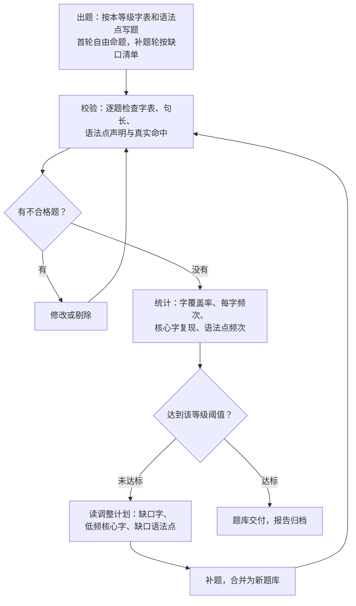

# 命题

发音评测系统的分级跟读题库与命题校验 pipeline。题库按《国际中文教育中文水平等级标准》的等级组织，每道题只使用该等级字表内的字和语法点；pipeline 负责校验每题是否合规、统计题库的字与语法覆盖是否达标。

完整工作流见 [skill.md](skill.md)。

## 工作流一览



对应 skill.md 的四个步骤：出题、校验、统计、调整。退出条件只有一个，即统计结论达标；每一轮的校验报告、统计报告和调整计划都存档在 reports 下。

## 快速上手

```bash
cd 命题

# 一键校验加统计（一级最终题库，已达标）
python scripts/pipeline.py --level 1 --bank banks/level1/final.json --tag check

# 合并新一轮补题后复跑
python scripts/pipeline.py banks/level1/round1.json banks/level1/round2_add.json --out banks/level1/round2.json
python scripts/pipeline.py --level 1 --bank banks/level1/round2.json --tag v2

# 只跑校验或只跑统计
python scripts/validate.py --level 1 --bank banks/level1/final.json --tag check
python scripts/stats.py    --level 1 --bank banks/level1/final.json --tag check
```

退出码：0 达标，1 有不合格题，2 覆盖未达标。未达标时读 reports/level1/adjust_plan_标签.json 里的缺口清单补题，再循环。

## 当前状态

一级（beginner）题库已完成命题闭环：256 题，300 字全覆盖（每个核心字至少出现 3 次），41 个语法点全覆盖（每点至少 2 次）。题目均为带拼音、带语法点标注的单句跟读题。

二到九级尚未建数据文件，建法见 skill.md 第九节。
